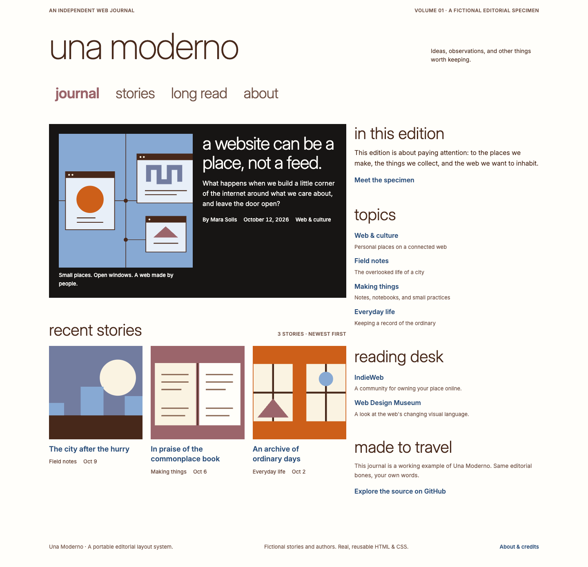

# Una Moderno

**Una Moderno — a portable editorial layout system for the independent web.**

Give an independent publication a considered editorial layout without adopting a theme framework. Start with semantic HTML and prebuilt CSS; carry the same tokens and markup into Tailwind or Astro when your project needs them.

**Framework-neutral at the core; Tailwind-ready when wanted.**



[See the mobile specimen](docs/images/editorial-mobile.png) · [See the open phone menu](docs/images/navigation-mobile-open.png) · [See a long-form article](docs/images/article-desktop.png) · [Read the markup contract](docs/architecture.md) · [Inspect the source CSS](packages/core/src/una.css)

## What works today

This v0.1 foundation is for independent writers, developers integrating a layout into a publishing platform, and maintainers evaluating portability. It includes:

- **A usable CSS core:** `--una-*` custom properties, semantic `una-*` classes, readable and minified distributions, and minimal HTML templates. No JavaScript, Node, Tailwind, or framework is needed in a consuming page.
- **A complete plain-HTML specimen:** a featured story, three recent-story thumbnails, useful sidebar modules, four readable articles, and an about page. All editorial content and authors are fictional.
- **An optional Tailwind v4 layer:** CSS-first aliases of core tokens, explicit source detection, and a compiled example using the same semantic structure.
- **An Astro reference:** a static site rendered from validated fictional fixtures. It demonstrates a normalized content boundary, not a live CMS integration.

The original 580:360 editorial split and 20px gap survive in a fluid layout. On smaller screens, the reading column comes first and the sidebar follows. Phone navigation uses a native hamburger disclosure with a full-width link list; tablet and desktop retain horizontal navigation. Visible focus, a skip link, and article contents work without client JavaScript.

## Try it

The foundation is on `codex/v0.1-foundation` while its pull request is under review. Packages are workspace-local and **not published to npm**. The API is pre-1.0 and may change with documented revisions.

For the full development setup, use **Node.js 22.23.4 or newer** and **npm 10.9.4**. `.nvmrc` records the tested Node version. Git and a network connection are needed for the clone and dependency installation.

```sh
git clone --branch codex/v0.1-foundation https://github.com/dinolatoga/una-moderno.git
cd una-moderno
npm ci
npm run build
npm run dev
```

Open <http://127.0.0.1:4321/> for the editorial specimen, <http://127.0.0.1:4321/examples/tailwind/> for the Tailwind proof, and <http://127.0.0.1:4321/astro/> for the built Astro reference. The server stays local; stop it with Ctrl+C.

**Only want HTML and CSS?** After cloning, open `examples/static-html/index.html` directly in a browser. The committed CSS, local font, images, and relative links work without installing anything. The minimal [index](packages/core/templates/index.html) and [article](packages/core/templates/article.html) templates also work directly from disk.

## Use plain HTML

Copy `packages/core/dist/una.css` or `una.min.css` into your own assets directory. The `.una` wrapper opts into the system; semantic elements remain your responsibility.

```html
<link rel="stylesheet" href="/assets/una.css" />
<body class="una">
  <a class="una-skip-link" href="#main">Skip to article</a>
  <main id="main" class="una-shell" tabindex="-1">
    <h1 class="una-title">A small place for your ideas</h1>
    <div class="una-prose">
      <p>Your words, at a comfortable reading measure.</p>
    </div>
  </main>
</body>
```

Override `--una-*` properties on `.una` to make it your own. Core CSS contains no external font request. For the specimen's display face, copy `packages/core/assets/` and separately link `fonts.css`; preserve its OFL license. See [core usage](packages/core/README.md).

## Add Tailwind when wanted

In this monorepo, the optional theme is available as `@una-moderno/tailwind`. Outside it, copy or vendor both package directories and resolve the CSS imports through your build tool. Do not run an npm registry install for these unpublished package names.

```css
@layer theme, base, components, utilities;
@import 'tailwindcss/theme.css' layer(theme);
@import '@una-moderno/core' layer(components);
@import '@una-moderno/tailwind';
@import 'tailwindcss/utilities.css' layer(utilities) source(none);
@source './index.html';
```

Use utilities such as `bg-una-blue` and `text-una-ink` alongside the semantic core. The mappings refer to `var(--una-*)`; token overrides therefore reach both layers. This example deliberately omits Tailwind Preflight so a second reset does not change the core contract. Source paths are relative to the stylesheet; add each template location explicitly and use complete class names.

```sh
npm run build:tailwind
```

See [the integration guide](packages/tailwind/README.md) and [working example](examples/tailwind/README.md) for the exact imports and source-detection behavior.

## Build the Astro reference

```sh
npm run build:astro
```

The reference emits static pages under `examples/astro/dist/` with a `/astro/` base, served by the root preview. Components render the same `una-*` markup from a validated story contract; no private code, unpublished content, credentials, or database is required. See [the example guide](examples/astro/README.md) and [adapter boundaries](docs/adapters.md).

**EmDash is experimental mapping work, not verified integration support.** No live EmDash store is queried in v0.1. WordPress is a v0.2 adapter target, not an included theme.

## Verify and contribute

```sh
npm run check
npx playwright install chromium
npm run test:browser
git diff --check
```

On Linux, Playwright may need `npx playwright install --with-deps chromium`. On macOS 13, the pinned Playwright cannot download its current Chromium; with an existing compatible Google Chrome installation, use `UNA_BROWSER_CHANNEL=chrome npm run test:browser`. CI uses bundled Chromium on Ubuntu. See [verification evidence and limitations](docs/verification.md) for exact browser coverage; passing axe checks is not an accessibility certification.

Start with [CONTRIBUTING.md](CONTRIBUTING.md), propose a focused issue, or submit a small PR with validation. [AGENTS.md](AGENTS.md) records repository rules. [SECURITY.md](SECURITY.md) explains responsible reporting; [the code of conduct](CODE_OF_CONDUCT.md) applies to project participation.

## Design, origin, and next steps

Una Moderno descends from Dino Latoga's 2008 Una WordPress theme. The archived source confirms the proportions, palette, featured-story rhythm, and useful sidebar. This is a new implementation; historical PHP, JavaScript, images, and CSS were not transplanted. The archive's licensing language is distinct from this repository's MIT license. [Historical evidence and provenance](docs/history.md) record the inspected sources and uncertainties.

[PRODUCT.md](PRODUCT.md) fixes the product boundary. [DESIGN.md](DESIGN.md) records the implemented design system; [machine-readable tokens](packages/core/tokens.json) are generated from source CSS. [Asset provenance](docs/assets.md) covers the original artwork, demo writing, font, and screenshots.

v0.2 targets a verified WordPress adapter and a tested CMS mapping. Broader browser testing, additional writing systems, dark-mode design, and a package publication policy remain open work. These are roadmap items, not current compatibility claims. See [CHANGELOG.md](CHANGELOG.md) for the unreleased foundation.

## License

Original code, templates, demo writing, and artwork are [MIT licensed](LICENSE), copyright Dino Latoga. Bundled Bricolage Grotesque is separately licensed under [SIL OFL 1.1](packages/core/assets/OFL.txt). No historical Una assets are redistributed.
